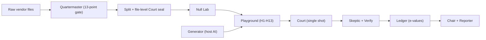

# banknifty-forensics-omega

`banknifty-forensics-omega` is an offline Python CLI (`bnf`). It runs a seven-role forensics lab on Bank Nifty spot, futures and options data, and separates statistically real regularities from noise while holding false claims to `<= 5.0%`.

It produces **diagnosis only**. There are no trading strategies, no entry or exit rules, no stops, no sizing, no P&L backtests and no broker calls.

- **For you if:** you are a Bank Nifty quantitative trader, a researcher, or an autonomous CLI operator who needs market diagnostics free of look-ahead leaks, plus a machine-readable handoff pack for a Strategy AI.
- **Not for you if:** you want strategies, signals, order execution or P&L backtests.
- **Status:** built from PRD `3.0.0` (V5 + Omega Never-Stop Engine). Requires Python `>=3.11,<3.15` and pandas 2.2 or 3.x.

[Quick start](#quick-start) | [How it works](#how-it-works) | [Usage](#usage) | [Outputs](#outputs) | [Project structure](#project-structure) | [Development](#development) | [Troubleshooting](#troubleshooting) | [Limits](#limits-and-non-goals) | [Security](#security-and-privacy) | [License](#license)

## Quick start

| Requirement | Version | Why |
|---|---|---|
| Python | `>=3.11,<3.15` | Offline runtime (Linux, macOS, Termux `lite` profile) |
| `numpy`, `scipy`, `pandas` | `>=1.26,<3.0` / `>=1.12,<2.0` / `>=2.2,<4.0` | Vectorised statistics (`seed=42`) and time-series tables |
| `pyarrow`, `pyyaml`, `jsonschema` | `>=14.0,<28.0` / `>=6.0,<7.0` / `>=4.21,<5.0` | Parquet store, YAML configs, schema validation |
| `scikit-learn` (optional extra `[models]`) | `>=1.4,<2.0` | `MODEL` cards (H7) and the Phase 6.3 classifier. When it is absent, those items report `NOT-RUN(ENV)` |
| `pytest`, `ruff`, `psutil` (extra `[dev]`) | `>=8.0,<10.0` / `>=0.4,<1.0` / `>=5.9,<8.0` | Tests, lint, memory checks |

1. Install the package (editable install keeps `config/`, `schemas/` and `prompts/` next to the code):

```bash
pip install -e '.[dev,models]'
```

2. Optionally copy the environment template (no secrets belong in it):

```bash
cp .env.example .env
```

3. Run the offline end-to-end self-test:

```bash
bnf selftest
```

Expected result: exit code `0`. The self-test does the following:
- builds a synthetic 450-day world under `runs/selftest_ws/`;
- runs the Quarantine Gate, split and seal, the Null Lab, Playground, Court, Skeptic, Ledger, report and verification;
- confirms that the planted `+0.8 ATR20` edge is `COURT-CONFIRMED` and graded `Ω-A`;
- confirms that the leaky `close_{t+1}` card is `LEAK-REJECTED`;
- confirms that a `BLOCKED_CARD` ticket is emitted for the missing option-OI column.

4. Put 2 to 3 days of raw vendor files (or an `updl` store) in `incoming/` and run the Sample-First intake:

```bash
bnf intake --sample-first
```

5. Run the full pipeline (`Ω-S0` to `Ω-S9`):

```bash
bnf run --config config/default_config.yaml --store-dir ./store --run-dir ./runs --seed 42
```

## How it works



1. **Intake.** Raw files in `incoming/` pass the 13-point Quarantine Gate (`Q1`–`Q13`) and become canonical Parquet partitions. `raw/` is never written. Rows are conserved exactly (`rows_in == rows_out + rows_dropped_logged`). Stale and filled vendor bars are masked to `NaN`; they are never dropped and never forward-filled.
2. **Split and seal.** A deterministic embargo is applied. The first 60% of usable days become the Playground. The newest 40% become a sealed Court block, whose date list is hashed (`court_days_hash`). Every Court day is tagged `VIRGIN` or `EXPOSED` from the Exposure Calendar (R28).
3. **Null Lab.** This runs on the real data shape before any exploration:
   - white-noise Court, Ledger and union false-positive rates must all be `<= 5%`;
   - planted-edge recall is measured at `delta in {0.1, 0.2, 0.3, 0.5, 0.8}`;
   - Leak Canary, the p-value peeking trap, the uncapped-V5 regression, 4 metamorphic tests and independent twin parity are checked.
4. **Playground.** Unlimited exploration across 13 Hunt Modes, using Playground days only. It makes zero claims. Every idea is logged to `idea_ledger.jsonl`, and the winner's curse is removed with Empirical-Bayes `deflated_lift`.
5. **Court.** A greedy-diverse docket is frozen with SHA-256 hashes: `K=20` by default (max 50), with pairwise event-day `Jaccard <= 0.50`. A power pre-check runs next. Each card is then tested once, in its frozen sign:
   - day-level sign-flip test with `B_court = max(10000, ceil(10/(alpha_k/K)))` draws;
   - pass threshold `p < alpha_k / K`, where `alpha_k = 0.05*6/(pi^2 k^2)`;
   - at least 30 event-days, otherwise the card is underpowered.
6. **Skeptic and verify.** An isolated script (it reads only `tables/*.csv`) runs 7 non-vacuous veto re-tests and assigns `Ω-A`, `Ω-B` or `Ω-C`. A standalone verifier then recomputes the numbers with an independent implementation.
7. **Ledger.** Frozen cards are tracked on post-freeze 10-day ticks. Each tick uses a baseline-centred, sign-gated Gaussian-mixture e-value (`c = 1.10`) and step-up e-BH (`M = 20,000`).
8. **Chair and Reporter.** This step produces `OWNER_BRIEF.md` (Hinglish), `AI_HANDOFF.md`, the main report, `strategy_input_pack.json`, and a Futility Certificate when nothing is confirmed. It also guarantees at least 3 open next actions.

The engine is 100% deterministic Python with zero outbound sockets. AI roles (Generator, Quartermaster prose, Maintainer) run outside the engine in the host agent and hand files in through `runs/<run_id>/ai_inputs/` and `proposals/`. Every AI file is schema-validated before use.

## Usage

Subcommands: `intake`, `null-lab`, `playground`, `court`, `ledger-tick`, `report`, `resume`, `run`, `selftest`.

| Flag | Default | Applies to | Meaning |
|---|---|---|---|
| `--config` | `config/default_config.yaml` | all | Frozen YAML parameters |
| `--store-dir` | `./store` | all | Canonical Parquet store root |
| `--run-dir` | `./runs` | all | Run artifacts root |
| `--incoming-dir` | `./incoming` | `intake` | Raw staging folder |
| `--sample-first` / `--no-sample-first` | on | `intake` | CP0 2–3 day sample probe before full ingest |
| `--seed` | `42` | all | Global RNG seed |
| `--max-ideas` | `0` | `playground`, `run` | Idea budget (`0` = until saturation or wall clock) |
| `--k-docket` | `20` | `court` | Docket size `1..50` |
| `--run-id` | `latest` | `resume`, `report` | `latest` or `^[A-Za-z0-9_-]{1,64}$` |
| `--cards-dir` | `runs/<run_id>/ai_inputs` | `playground`, `run` | Host-agent Idea Card v2 directory |
| `--tokens-used`, `--cost-usd` | `0` | `playground`, `run` | Optional host-agent telemetry (enforced only when a cap is configured) |
| `--max-wall-min` | `240` | `playground`, `run` | Wall-clock budget enforced by `bnf` |
| `--profile` | `full` | all | `full` or `lite` (Termux: `workers <= 2`, no scikit-learn) |
| `--json-logs` | off | all | Structured JSONL logs on stdout |

### Exit codes

| Code | Meaning | What to do |
|---|---|---|
| `0` | `OK` | Read `OWNER_BRIEF.md`, then `AI_HANDOFF.md` |
| `2` | `PARTIAL`: a budget was reached, or a verification mismatch was demoted. A `PARTIAL` marker, `run_state.json`, `OWNER_BRIEF.md` and `AI_HANDOFF.md` are written | Run `bnf resume --run-id <id>` |
| `3` | `INPUT_OR_SCHEMA_ERROR`: unreadable input, bad CLI arguments (argparse usage errors never exit `2`), corrupt ledger, lock contention, path or symlink violation, or a schema failure | Fix the reported input |
| `4` | `MODE_INVALID`: a critical tripwire fired (row loss, Court seal breach, docket tamper, peeking path, Null Lab FPR `> 5%`, missed leak canary, or a critical scorecard item) | Read the tripwire id printed on stderr |
| `5` | `COMPLETE_WITH_GAPS`: the run is complete and verified, but a data family is missing or a `BLOCKER` ticket is open | Fetch the data named in `tickets/open_tickets.yaml` |

### Environment variables

| Name | Default | Meaning |
|---|---|---|
| `BNF_STORE_DIR` | `./store` | Store root when `--store-dir` is not given |
| `BNF_RUN_ENV` | `local_cli` | Execution environment label |
| `BNF_SEED` | `42` | Seed when `--seed` is not given |
| `BNF_LOCK_DIR` | `~/.bnf/locks` | App-private lock directory (Android shared storage has no reliable `flock`) |
| `NS_C`, `NS_D`, `NS_BATCH`, `NS_ONLY_P4`, `NS_ONLY_P56`, `NS_WORLDS` | `1.10`, `450`, `300`, `0`, `0`, `all` | `omega_sim.py` simulation controls |

Broker tokens are never read. `UPSTOX_RO_TOKEN` and every `*TOKEN*` or `*SECRET*` variable are removed from the process environment at start-up.

## Outputs

Per run, under `runs/<run_id>/`:
- run state and logs: `run_state.json`, `pipeline.jsonl`, `data_passport.md`, `test_plan.md`, `digests/S<k>.md`;
- Playground and Court: `idea_ledger.jsonl`, `court_docket.json`;
- futility outputs: `futility_certificate.yaml`, `next_actions.yaml`;
- tables: `findings_registry.csv` (37 columns) and `tables/*.csv`;
- reader-facing files: `BANKNIFTY_DATA_FORENSICS_REPORT.md` (`<= 60,000` tokens, 13 sections plus the 44-item Appendix Z scorecard), `strategy_input_pack.json` (`schema_version` `1.1`), `OWNER_BRIEF.md` (`<= 40` lines), `AI_HANDOFF.md` (`<= 200` lines, 12 parts), `RUN_DIFF.md`.

Lifelong state (git-ignored): `ledger/ledger.json`, `ledger/cards.csv`, `tickets/open_tickets.yaml`, `proposals/*.yaml`, `bricks_pending.yaml`, and `cache/<data_version>/`.

Canonical store layout: `[week_*/store/<split>/]<table>/underlying=<X>/trading_date=<YYYY-MM-DD>/part-*.parquet` (the `updl` layout is accepted as is).

## Project structure

```text
banknifty-forensics-omega/
├── .github/workflows/ci.yml   # pytest, lint, peeking ban, Skeptic isolation, secret scan
├── config/                    # defaults, bricks, targets T1-T8, AP01-AP36, era calendar
├── prompts/                   # brain.md (<=150 lines) + generator, quartermaster, handoff prompts
├── schemas/                   # 6 versioned JSON Schemas
├── src/bn_forensics/          # 19 modules (data, stats, Playground/Court/Ledger, truth layer, CLI)
├── tests/                     # 6 suites + conftest (synthetic fixtures generated at test time)
│   └── fixtures/sample_spot_3d.csv
├── README.md  LICENSE  .gitignore  pyproject.toml  .env.example  Makefile
```

`skeptic_checks.py` and `twin_impl.py` import nothing from `core_stats.py` or any data loader. An AST test enforces this.

## Development

```bash
pytest -q && make lint && bnf selftest
```

| Make target | Runs |
|---|---|
| `make test` | `pytest -q` |
| `make lint` | `ruff check src/ tests/` |
| `make selftest` | `bnf selftest` |
| `make null-lab` | `bnf null-lab` |
| `make run` | `bnf run` |

## Troubleshooting

| Symptom | Likely cause | Fix |
|---|---|---|
| Exit `2` + `PARTIAL` marker | Wall-clock or idea budget reached | `bnf resume --run-id <id>` |
| Exit `3` on any command | Bad flag, path outside the allowed root, symlink, corrupt ledger, or another `bnf` holding the lock | Fix the reported item; wait for the other run |
| Exit `4`, `row_ledger_ok=false` | Rows lost in an adapter transform | Fix the adapter so rows are conserved |
| Exit `4`, `F31`/`F32` | Court file read during Playground, or docket changed after freeze | Never read Court partitions before the docket hash |
| `COURT-UNDERPOWERED` | Fewer than 30 Court event-days | Wait for forward days (Ledger) or add history |
| `POWER-DEFERRED` | Power pre-check failed; no alpha spent | Wait for `N_min = 60` fresh days |
| `DAY-LIMITED` | `< 120` usable days | Add history; nothing can be `SUPPORTED` |
| `CALIBRATION WARNING` | Planted recall `> 25%` off the analytic MDE | Recalibrate before trusting Court |

## Limits and non-goals

- **Diagnosis-only:** no strategies, entries, exits, stops, targets, sizing, equity curves, P&L backtests or first-touch statistics (NG-1, NG-2).
- **Offline and broker-neutral:** zero broker calls, credentials or orders (NG-3).
- **No p-value peeking:** forward tracking uses anytime-valid e-values only (NG-4).
- **No bare "nothing found":** a zero-confirmation run always emits a Futility Certificate with numeric `N*` and `>= 3` next actions (NG-5).
- **Power ceiling:** about 490 Era-B days give about 196 Court days and a Court MDE of about `0.54 sd` (`~0.52 ATR20`). Era-A backfill lowers Court MDE only in the `global` split mode (`D-11`).
- **Exposure:** every Era-B day up to 2026-11-12 was already used by earlier research, so those confirmations are `EXPOSED-COURT` and capped at `Ω-B` (R28, `D-12`).

## Security and privacy

- `raw/` and source stores are never written. A guarded writer refuses protected roots, and SHA-256 manifests are compared before and after.
- Data text is treated only as data: there is no `eval` or `exec`, and all YAML is loaded with the safe loader.
- Paths under `incoming/`, `store/`, `runs/`, `proposals/` and `cache/` must resolve inside their root, and no part of the path may be a symlink (violations exit `3`).
- No secrets or personal data appear in the repository, reports or the strategy pack. CI fails on token-like strings.

## License

Proprietary, all rights reserved (PRD default for `D-9`). See `LICENSE`.
