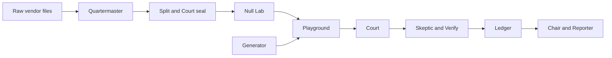

# banknifty-forensics-omega&lt;!-- GAP-8: Repository name banknifty-forensics-omega is a PRD proposal; confirm or pick alternative (bn-forensics-lab, banknifty-omega-lab) before git init; Founder decides --&gt;

Diagnosis-only Bank Nifty forensics CLI separating statistical regularities from noise with <= 5.0% false-positive control.

`banknifty-forensics-omega` is a local Python CLI and seven-role quantitative forensics lab for Bank Nifty spot, futures, and options data. It pairs a 13-point data-quarantine layer with a three-room statistical engine: unlimited Playground exploration, single-shot diverse Court verdicts, and lifelong anytime-valid e-value Ledger tracking.

On ~490 post-November 2024 monthly-expiry trading days, unconstrained searching or repeated re-testing produces 32.5% to 100.0% false-positive rates on pure noise, while fixed checklists and 2-round caps cut moderate-signal recall to 2.5%. This lab decouples exploration from out-of-sample claims and requires numeric Futility Certificates whenever zero edges pass.

- **For you if:** you are a Bank Nifty quantitative trader, researcher, or autonomous CLI operator who needs leak-free market diagnostics and machine-readable Strategy AI handoff packs.
- **Not for you if:** you want trading strategies, entry or exit rules, stop-losses, position sizing, trade P&L backtests, or live broker order execution.
- **Status:** PRD v2.1.0, Draft for Founder Approval and Autonomous Build (Python `>=3.11,<3.13`).

> [!NOTE]
> This repository is in pre-build specification status. Every command below is specified in the PRD and has not yet been run against a built repository.

[Example output](#example-output) | [Quick start](#quick-start) | [Features](#features) | [How it works](#how-it-works) | [Usage](#usage) | [Project structure](#project-structure) | [Development](#development) | [Troubleshooting](#troubleshooting) | [Limits and non-goals](#limits-and-non-goals) | [Security and privacy](#security-and-privacy) | [Roadmap](#roadmap) | [License](#license)

## Example output

Freezing a single-shot diverse Court docket (`court_docket.json`):

```bash
bnf court --k-docket 20 --seed 42
```

```text
{"schema_version": "1.0", "session": 1, "alpha_k": 0.030396, "K": 20, "jaccard_max": 0.5, "frozen_at": "2026-11-22T16:00:00+05:30", "cards": [{"card_id": "C-0412", "sign": 1, "jaccard_max_vs_chosen": 0.31, "lane": "M"}]}
```<!-- GAP-3: No terminal screenshot or GIF exists in the repository tree; capture a real bnf selftest screenshot after build; Maintainer decides -->

## Quick start

### Prerequisites

| Requirement | Version | Why you need it |
|---|---|---|
| Python | `>=3.11,<3.13` | Offline runtime for Linux, macOS, or Termux-capable local environments |
| `numpy`, `scipy`, `pandas` | `>=1.26,<3.0` / `>=1.12,<2.0` / `>=2.2,<3.0` | Vectorized statistics (`seed=42`), quantiles, and time-series tables |
| `pyarrow`, `pyyaml`, `jsonschema` | `>=15.0,<19.0` / `>=6.0,<7.0` / `>=4.21,<5.0` | Partitioned canonical Parquet store I/O and schema validation |
| `scikit-learn` | `>=1.4,<2.0` | Regularised logistic regression and shallow GBDT for `MODEL` cards |
| `pytest`, `ruff` | `>=8.0,<9.0` / `>=0.4,<1.0` | Automated acceptance tests and static lint |

> [!WARNING]
> Per-run LLM API token and USD cost ceilings are not yet locked in `config/default_config.yaml`. Set an explicit numeric cap before running autonomous Playground loops; the Chair halts with exit code `2` before exceeding the configured cap.<!-- GAP-5: Per-run AI API token and USD cost ceiling is an open decision; require explicit numeric cap before Run-1; Founder decides -->

### Steps

1. Clone the repository and enter the project directory:<!-- GAP-1: Repository URL missing from PRD; replace placeholder after repository creation; Founder decides -->
```bash
git clone <REPO_URL>
cd banknifty-forensics-omega
```
Expected result: Local copy of the repository with `pyproject.toml` and `config/default_config.yaml` present.

2. Install the package from `pyproject.toml` in your Python `>=3.11,<3.13` environment and copy `.env.example` if you want to override `BNF_STORE_DIR`, `BNF_RUN_ENV`, or `BNF_SEED`.&lt;!-- GAP-2: Exact package installer command and lockfile tool (uv, poetry, or pip) are not locked in the PRD; lock one installer in Stage 1; Founder or Builder decides --&gt;
Expected result: The `bnf` CLI command is available on your `PATH`.

3. Run the offline synthetic self-test to verify every stage end to end:
```bash
bnf selftest
```
Expected result: Exits with code `0`, confirming Quarantine Gate, pre-Playground Null Lab, Playground hunt, Court confirmation of the planted `+0.8 ATR20` edge, isolated Skeptic grading (`Ω-A`), verification pass, and a valid `strategy_input_pack.json`.

4. Place 2 to 3 days of raw vendor files in `incoming/` and run Sample-First intake:
```bash
bnf intake --sample-first
```
Expected result: Prints the Quarantine Gate identity echo-back, validates timestamp conventions (`START` or `END`), and writes canonical Parquet partitions to `store/` plus `data_passport.md`.

5. Run the full diagnostic pipeline on your canonical store:
```bash
bnf run --config config/default_config.yaml --store-dir ./store --run-dir ./runs --seed 42
```
Expected result: Exits with code `0`. You now have a verified `BANKNIFTY_DATA_FORENSICS_REPORT.md`, a 37-column `findings_registry.csv`, `strategy_input_pack.json`, and either confirmed findings or a numeric `futility_certificate.yaml`.

## Features

| Capability | What it does | Status |
|---|---|---|
| Canonical store adapter and 13-point Quarantine Gate | Adapts raw files into partitioned Parquet, enforces exact row conservation, checks timestamps, tags `*_DERIVED` provenance, and keeps `raw/` read-only | Core |
| Broker-neutral Data Request Tickets (DRTs) | Emits non-blocking YAML tickets ranked by Value of Information with Sample-First specs when data, calendar, or power gaps exist | Core |
| Split and file-level Court seal | Applies deterministic embargo and chronological 60% Playground / 40% sealed Court split with file-level read lock | Core |
| Pre-Playground Omega Null Lab | Audits Court and Ledger null FPR (`<= 5.0%`), planted-edge recall, Leak Canary, peeking traps, 4 metamorphic tests, and independent twin parity | Core |
| Consolidated stats and AP01-AP36 X-ray | Computes gap-free intraday `ATR20`, day/week-block bootstrap CIs (`seed=42`), whole-day permutations, logged horizon caps, and deterministic 2A.3 verdicts | Core |
| Idea Card v2 compiler and boundary gate | Compiles `RULE`, `MODEL`, and `PROFILE` cards from ~40 causal bricks; rejects look-ahead references and trading-strategy or first-touch logic | Core |
| Unlimited Playground Never-Stop Engine | Runs all 13 Hunt Modes (`H1` to `H13`) with zero round cap, Idea Ledger logging, cluster saturation tracking, and resumable checkpoints | Core |
| Shrinkage, Mechanism, and Orthogonal Basis | Computes Empirical-Bayes `deflated_lift`, cost-matched tradability tags, dose-gradient checks, AP-clone-aware Novelty Score, and independent effect count | Core |
| Single-shot diverse Court | Freezes `K=20` (max `50`, `Jaccard <= 0.50`) SHA-256 docket, tests once at `p < alpha_k / K` with `event_days >= 30`, then graduates Court days | Core |
| Isolated 7-test Skeptic and Omega grades | Runs 7 non-vacuous post-Court veto re-tests with zero `core_stats.py` or raw imports and assigns `Ω-A`, `Ω-B`, or `Ω-C` grades | Core |
| Lifelong e-value Ledger | Tracks frozen cards on 10-day post-freeze ticks via anytime-valid Gaussian-mixture e-values (`c=1.10`) and e-BH (`M=20,000`), banning p-value peeking | Core |
| Chair, Futility Certificate, verify, and reporting | Enforces Never-Idle (`>= 3` actions in `next_actions.yaml`), `futility_certificate.yaml`, standalone verification, `<= 60,000`-token report, and `strategy_input_pack.json` | Core |

## How it works



Raw vendor files enter `incoming/` and pass through the Quartermaster's 13-point Quarantine Gate into canonical Parquet partitions while `raw/` stays read-only. The split manager applies a deterministic embargo, locks the newest 40% of usable days as sealed Court files, and runs the mandatory Null Lab audit before exploration starts. In Playground, the Generator and Judge run unlimited exploration across 13 Hunt Modes (`H1` to `H13`) on the first 60% of usable days with zero claims allowed. A greedy-diverse docket (`K=20` default, `Jaccard <= 0.50`) is frozen with SHA-256 hashes before opening Court days once at `p < alpha_k / K` (`alpha_k = 0.05 * 6 / (pi^2 * k^2)`), followed by 7 isolated Skeptic veto re-tests and standalone verification. Frozen cards then enter the lifelong e-value Ledger for 10-day post-freeze ticks, and the Chair renders the report, `strategy_input_pack.json`, and a Futility Certificate if zero cards confirm.

### Operational roles

| Role | Type | What it does |
|---|---|---|
| Generator | AI | Authors Idea Cards v2 from the Blind Packet and `<= 8`-line digests across Hunt Modes `H1` to `H13`; submits brick, target, persona, and mechanism proposals |
| Judge | Code | Compiles cards, enforces leak and boundary gates, runs Playground X-ray, computes `deflated_lift`, freezes Court dockets, runs Court, and runs isolated Skeptic checks |
| Null Lab | Code | Runs pre-Playground white-noise, planted-edge, Leak Canary, peeking-trap, metamorphic, and independent twin-implementation audits at real sample size `n` |
| Quartermaster | Hybrid | Adapts raw files to canonical Parquet, runs Sample-First and 13-point Quarantine checks, tracks row conservation and eras, and emits VoI-ranked DRTs |
| Ledger | Code | Updates anytime-valid Gaussian-mixture e-values (`rho in {0.15, 0.30, 0.60}`, `c=1.10`) and e-BH (`M=20,000`) on 10-day post-freeze ticks |
| Chair | Hybrid | Orchestrates the 10-stage workflow, checks `brain_hash` and `library_hash`, monitors 25 tripwires, enforces Never-Idle and Futility Certificates, and drives reporting |
| Maintainer | Hybrid | Reviews `proposals/` offline between runs, promotes verified library additions, and runs the offline 10-question Handoff Test (`>= 9/10` pass bar) |

Deterministic Python code executes all statistical math, leak checks, shrinkage, Court p-values, e-values, Skeptic vetoes, and verification; AI roles generate hypotheses, DRT prose, and report narratives only. Every AI output is validated against versioned JSON Schemas in `schemas/` via `schemas_validator.py` before downstream use, with at most 2 to 3 retries and deterministic `PARTIAL` checkpointing (`exit 2`) on cap.

## Usage

### Common tasks

Run a bounded Playground exploration and checkpoint cleanly if the cap is reached:
```bash
bnf playground --max-ideas 5000 --seed 42
```
Expected result: Logs every evaluated and discarded card hash to the Idea Ledger with zero Court reads, exiting with code `0` on saturation or `2` on budget pause.

Run the mandatory pre-Playground Null Lab audit at real sample size:
```bash
bnf null-lab --seed 42
```
Expected result: Verifies Court and Ledger null FPR (`<= 5.0%`), planted-edge recall, Leak Canary rejection, 4 metamorphic tests, and twin parity.

Update lifelong e-values after 10 new forward trading days arrive, then resume reporting:
```bash
bnf ledger-tick
bnf resume --run-id latest
```
Expected result: Updates `ledger/ledger.json` and `ledger/cards.csv` strictly on post-freeze days and regenerates reports for the latest run.

### CLI reference

Subcommands: `intake`, `null-lab`, `playground`, `court`, `ledger-tick`, `report`, `resume`, `run`, `selftest`.

| Flag | Default | Meaning | Example |
|---|---|---|---|
| `--config` | `config/default_config.yaml` | Path to frozen YAML parameter config (all subcommands) | `bnf run --config config/default_config.yaml` |
| `--store-dir` | `./store` | Canonical Parquet store root (all subcommands) | `bnf run --store-dir ./store` |
| `--run-dir` | `./runs` | Output directory for run artifacts (all subcommands) | `bnf run --run-dir ./runs` |
| `--incoming-dir` | `./incoming` | Staging folder for raw vendor files (`intake`) | `bnf intake --incoming-dir ./incoming` |
| `--sample-first` | `true` | Enforce 2 to 3 day sample probe before full ingest (`intake`) | `bnf intake --sample-first` |
| `--seed` | `42` | Global deterministic RNG seed (all subcommands) | `bnf null-lab --seed 42` |
| `--max-ideas` | `0` | Optional Playground compute cap; `0` runs until saturation or token cap (`playground`) | `bnf playground --max-ideas 5000` |
| `--k-docket` | `20` | Court docket size, `1 <= K <= 50` (`court`) | `bnf court --k-docket 20` |
| `--run-id` | `latest` | Target run ID to resume or render (`resume`, `report`) | `bnf report --run-id latest` |
| `--json-logs` | `false` | Emit structured JSONL logs to stdout (all subcommands) | `bnf selftest --json-logs` |

### Exit codes

| Code | Meaning | What to do |
|---|---|---|
| `0` | `OK` — Stage or full pipeline completed and passed verification | Review outputs in `runs/` and `strategy_input_pack.json` |
| `2` | `PARTIAL` — Compute or token cap reached, or unresolved verification mismatch demoted | Inspect `run_state.json` and resume via `bnf resume --run-id latest` |
| `3` | `INPUT_OR_SCHEMA_ERROR` — Unreadable input, invalid flags, path/symlink violation, lock contention, corrupt ledger, or schema error | Fix the reported input, `.bnf.lock` contention, or schema field and re-run |
| `4` | `MODE_INVALID` — Critical tripwire breach (row loss, Court seal breach, docket tamper, p-value peeking, Null Lab FPR > 5.0%, Leak Canary miss, or critical scorecard fail) | Inspect the tripwire log and `MODE: INVALID` banner; fix root cause before re-running |
| `5` | `DEGRADED_MODE` — Code execution unavailable; degraded report and DRTs emitted | Run in a local Python `>=3.11,<3.13` environment with code execution enabled |

&lt;details&gt;
&lt;summary&gt;Configuration, environment variables, and input/output layouts&lt;/summary&gt;

#### Environment variables

| Name | Default | Required | Meaning |
|---|---|---|---|
| `BNF_STORE_DIR` | `./store` | No | Canonical Parquet store root |
| `BNF_RUN_ENV` | `local_cli` | No | Execution environment identifier |
| `BNF_SEED` | `42` | No | Global deterministic RNG seed |
| `NS_C` | `1.10` | No | Variance-inflation constant for `omega_sim.py` |
| `NS_D` | `450` | No | Simulated trading-day count for `omega_sim.py` |
| `NS_BATCH` | `300` | No | Simulated batch size for `omega_sim.py` |
| `NS_ONLY_P4` | `0` | No | Run only protocol 4 in `omega_sim.py` |
| `NS_ONLY_P56` | `0` | No | Run only protocols 5 and 6 in `omega_sim.py` |
| `NS_WORLDS` | `all` | No | Synthetic world filter for `omega_sim.py` |

#### Input and output layouts

- **Canonical input store:** `week_*/store/<split>/<table>/underlying=<X>/trading_date=<YYYY-MM-DD>/*.parquet` (core tables: `spot_1m`, `fut_1m`, `bars_3m`, `bars_15m`, `spot_1d`, `chain_metrics_1m`, `daily_metrics_DERIVED`, `iv_daily_DERIVED`; cross-asset tables: `stock_1m`, `global_1m`, `vix_1m`, `vix_1d`).
- **Run outputs (`runs/`):** `run_state.json`, `data_passport.md`, `test_plan.md`, `court_docket.json`, `futility_certificate.yaml`, `next_actions.yaml`, `BANKNIFTY_DATA_FORENSICS_REPORT.md` (`<= 60,000` tokens), `findings_registry.csv` (37 columns), `tables/*.csv`, and `strategy_input_pack.json`.
- **Lifelong state (git-ignored):** `ledger/ledger.json`, `ledger/cards.csv`, `tickets/open_tickets.yaml`, `proposals/*.yaml`, `bricks_pending.yaml`, and rebuildable `cache/`.

&lt;/details&gt;

## Project structure

```text
banknifty-forensics-omega/
├── .github/
│   └── workflows/        # CI pipeline (pytest, ruff lint, peeking ban, Skeptic isolation)
├── config/               # Frozen defaults, ~40 bricks, 8 targets, AP01-AP36 cards, era calendar
├── prompts/              # Versioned LLM prompts (brain.md <=150 lines, role and handoff prompts)
├── schemas/              # 6 versioned JSON Schemas for code-side validation
├── src/
│   └── bn_forensics/     # 19 Python modules for data, stats, Omega rooms, truth layer, and CLI
├── tests/
│   └── fixtures/         # Synthetic 3-day 1-min Bank Nifty OHLCV fixture
├── README.md             # Project overview, setup, and CLI reference
├── LICENSE               # Repository license file
├── .gitignore            # Git-ignored stores, runs, caches, raw/, incoming/, and .env
├── pyproject.toml        # Python 3.11+ package manifest, dependencies, and bnf entry point
├── .env.example          # Non-secret environment variable template
└── Makefile              # Developer task shortcuts (test, selftest, null-lab, lint, run)
```

&lt;details&gt;
&lt;summary&gt;Full repository tree (49 files)&lt;/summary&gt;

```text
banknifty-forensics-omega/
├── README.md
├── LICENSE
├── .gitignore
├── pyproject.toml
├── .env.example
├── Makefile
├── .github/workflows/ci.yml
├── config/
│   ├── default_config.yaml
│   ├── bricks.yaml
│   ├── targets.yaml
│   ├── ap_cards.yaml
│   └── era_calendar.yaml
├── prompts/
│   ├── brain.md
│   ├── generator_agent.md
│   ├── quartermaster_agent.md
│   └── handoff_evaluator.md
├── schemas/
│   ├── idea_card_v2.schema.json
│   ├── court_docket.schema.json
│   ├── drt.schema.json
│   ├── run_state.schema.json
│   ├── futility_certificate.schema.json
│   └── strategy_input_pack.schema.json
├── src/bn_forensics/
│   ├── __init__.py
│   ├── cli.py
│   ├── core_stats.py
│   ├── quartermaster.py
│   ├── split_seal.py
│   ├── xray_phases.py
│   ├── bricks_compiler.py
│   ├── playground.py
│   ├── shrinkage_basis.py
│   ├── court.py
│   ├── ledger.py
│   ├── skeptic_checks.py
│   ├── null_lab.py
│   ├── twin_impl.py
│   ├── verify_checks.py
│   ├── chair.py
│   ├── reporter.py
│   ├── schemas_validator.py
│   └── omega_sim.py
└── tests/
    ├── conftest.py
    ├── test_quartermaster.py
    ├── test_compiler_and_boundary.py
    ├── test_court_and_omega.py
    ├── test_ledger_evalue.py
    ├── test_truth_and_skeptic.py
    ├── test_chair_and_reporting.py
    └── fixtures/sample_spot_3d.csv
```

&lt;/details&gt;

## Development

Naming convention: `kebab-case` for the repository name, `snake_case` for Python modules, YAML configs, and JSON Schemas, and `UPPERCASE` for root docs (`README.md`, `LICENSE`, `Makefile`). `skeptic_checks.py` and `twin_impl.py` must keep zero imports from `core_stats.py` or raw data loaders.

Run the full test suite, static lint, and offline end-to-end acceptance scenario:
```bash
pytest -q && make lint && bnf selftest
```

## Troubleshooting

| Symptom | Likely cause | Fix |
|---|---|---|
| Exit code `2` with `PARTIAL` marker | Compute or token ceiling reached, or unresolved verification mismatch demoted | Run `bnf resume --run-id latest` after reviewing `run_state.json` or raising the cap |
| Exit code `3` on intake or ledger tick | Schema error, symlink/path-traversal outside allowed root, corrupt ledger, or `.bnf.lock` contention | Fix the reported field or path, wait for concurrent runs to finish, and re-run |
| Exit code `4` with `MODE: INVALID PIPELINE` | Pre-Playground Null Lab Court FPR `> 5.0%`, Leak Canary miss, metamorphic fail, or twin mismatch | Inspect `tables/null_lab_summary.csv` and fix the statistical or compiler defect |
| Exit code `4` on `row_ledger_ok=false` | Silent row loss during `dropna`, merge, or resampling in Quarantine Gate | Fix the adapter transform so `rows_in == rows_out + rows_dropped_logged` |
| Exit code `4` on Court seal or docket hash mismatch | Playground code accessed sealed Court files or docket changed after freeze | Remove Court reads from Playground and re-freeze `court_docket.json` prior to Court |
| `COURT-UNDERPOWERED` verdict | Card had `< 30` distinct event days inside the sealed Court block | Accumulate more forward days or add Era-A backfill via Sample-First DRT |
| `DAY-LIMITED` banner on report | Fewer than `120` usable trading days in store | Ingest additional history; zero approaches receive `SUPPORTED FOR HYPOTHESIS` under `120` days |
| `CALIBRATION WARNING` from Null Lab | Planted-edge empirical recall diverged `> 25%` from analytic MDE | Recalibrate bootstrap or variance-inflation constant `c` before trusting Court verdicts |

## Limits and non-goals

- **Diagnosis-only boundary:** Produces zero trading strategies, entry or exit rules, stop-losses, targets, position sizing, equity curves, trade P&L backtests, or first-touch path-dependent statistics.
- **Offline and broker-neutral:** Executes zero live broker API calls, credential storage, or order execution; external files enter through `incoming/`.
- **No p-value peeking:** Sequential peek-and-stop on p-values is banned in production code; only anytime-valid e-values (`M=20,000`, `c=1.10`) run in the Ledger.
- **No bare empty stops:** Zero-confirmation runs must emit `futility_certificate.yaml` with numeric `N*` and at least `3` open actions in `next_actions.yaml`.
- **Small-sample power ceiling:** On ~490 Era-B days (~196 Court days), Court MDE is `~0.52 sd`; adding Era-A spot and futures backfill cuts Court MDE to `~0.33 sd`.&lt;!-- GAP-6: Round-trip costs, official NSE expiry/holiday calendar (Era B2 Jan-Aug 2025 weekday conflict), Era-A backfill inclusion, and broker plan tier are open user decisions; Founder decides --&gt;
- **Resource and size ceilings:** `<= 180,000 ms` target for 1,100-day 3-min Court + X-ray batch on 4-core CPU (proposal), `<= 4,096 MB` RSS (proposal), `prompts/brain.md <= 150` lines, core report `<= 60,000` tokens, and `event_ledger.csv` auto-compressed above `25 MB`.

## Security and privacy

- **Read-only raw data:** `raw/` is strictly immutable across every stage and verified via SHA-256 checksums.
- **Prompt-injection and path defense:** All text inside market CSV/Parquet files is treated strictly as data with zero `eval()` or `exec()` calls; symlinks are rejected and all paths under `incoming/`, `store/`, `runs/`, and `proposals/` enforce `Path.resolve().is_relative_to(allowed_root)` (`exit 3`).
- **No secrets or PII:** Zero broker credentials, API tokens, or personal account IDs are stored in the repository, `data_passport.md`, reports, or `strategy_input_pack.json`.
- **Vulnerability reporting:** No `SECURITY.md` file or security contact is defined in the repository tree yet.&lt;!-- GAP-7: SECURITY.md, CONTRIBUTING.md, CHANGELOG.md, support channel, and PR policy are omitted in the PRD tree; add before opening repository externally; Founder or Maintainer decides --&gt;

## Roadmap

- Cross-asset and era replication across auxiliary tables (`stock_1m`, `global_1m`, `vix_1m`, `vix_1d`, `NIFTY`, `FINNIFTY`) with `ERA-CONSISTENT` and `ERA-SPECIFIC` tags (planned).
- Proposal channels and Maintainer inbox for new bricks, targets, personas, and mechanisms (planned).
- Reproducible Omega simulation harness (`omega_sim.py`) and offline 10-question Handoff Test (`prompts/handoff_evaluator.md`) (planned).
- Degraded Mode fallback when code execution is unavailable (planned).
- Online e-LOND / unbounded-M online e-BH Ledger upgrade after formula verification and Null Lab calibration (planned).
- Bandit budget allocation across personas and brick families once sufficient forward Ledger history exists (planned).
- Separate external broker fetch plugins (Upstox, Angel One) feeding `incoming/` (planned).

## Contributing

No `CONTRIBUTING.md`, pull-request policy, or support channel is defined in the PRD yet; confirm contribution rules before opening the repository beyond the founder.

## License

License: not yet chosen.&lt;!-- GAP-4: Repository LICENSE choice (MIT, Apache-2.0, or Proprietary) is an open decision; recommended default Proprietary (All Rights Reserved); Founder decides --&gt;

&lt;!--
MAINTAINER NOTES (DELETE BEFORE PUBLISHING)

Generated from: PRD &quot;Bank Nifty Deep Data Forensics Lab (V5 + Omega Never-Stop Engine)&quot; v2.1.0 (2026-11-22)
REPO_STATE: PRE_BUILD
MODE: CREATE
Date: 2026-11-22 (Asia/Kolkata IST)
Primary reader: Bank Nifty Trader / Founder (P-1) and Autonomous Builder &amp; CLI Operator (P-3)
Secondary reader: Contributors / Maintainer (AG-07)
First success moment: Quick start step 3 (bnf selftest exits with code 0, confirming planted edge graded Omega-A and valid strategy_input_pack.json)

GAPS:
GAP-1 | Quick start step 1 | REPO_URL missing from PRD; used &lt;REPO_URL&gt; placeholder once and omitted CI badge | Set actual GitHub URL after repo creation | Founder
GAP-2 | Quick start step 2 | Exact package installer command and lockfile tool (uv, poetry, pip) not locked in PRD | Lock one installer command in Stage 1 | Founder / Builder
GAP-3 | Example output | No screenshot or terminal capture file exists in repository tree | Capture real bnf selftest output screenshot after build | Maintainer
GAP-4 | License | Repository LICENSE choice (D-9) undecided | Proprietary (All Rights Reserved) | Founder
GAP-5 | Quick start alert | Per-run LLM API token and USD cost ceiling (D-8) undecided | Require explicit numeric cap in config/default_config.yaml before Run-1 | Founder
GAP-6 | Limits and non-goals | Round-trip costs (D-1), official NSE expiry/holiday calendar (D-4, CF-11 Era B2 conflict), Era-A backfill (D-3), and broker plan fee (D-10) undecided | Leave costs unprovided, default Era B2 to Last Thursday, run Sample-First CP0 before Era-A | Founder / Trader
GAP-7 | Security and privacy / Contributing | SECURITY.md, CONTRIBUTING.md, CHANGELOG.md, support channel, and PR policy omitted by PRD hygiene design | Add before opening repository externally | Founder / Maintainer
GAP-8 | Header H1 | Repository name banknifty-forensics-omega is a PRD proposal (PR-13) | Confirm name before initial git init | Founder
GAP-9 | Source completeness | Legacy scripts 01 to 07 and simulation scripts referenced in PRD sources were not attached (clean-room replacement in src/bn_forensics/) | Verify parity via twin_impl.py if local legacy scripts exist | Founder / Operator

COMMAND VERIFICATION (PRE_BUILD, all UNVERIFIED because repository is not yet built):
Example output step 1: UNVERIFIED (PRE_BUILD)
Quick start step 1: UNVERIFIED (PRE_BUILD)
Quick start step 3: UNVERIFIED (PRE_BUILD)
Quick start step 4: UNVERIFIED (PRE_BUILD)
Quick start step 5: UNVERIFIED (PRE_BUILD)
Usage task 1: UNVERIFIED (PRE_BUILD)
Usage task 2: UNVERIFIED (PRE_BUILD)
Usage task 3: UNVERIFIED (PRE_BUILD)
Development step 1: UNVERIFIED (PRE_BUILD)

PROVENANCE MAP:
Header &amp; First screen -&gt; PRD Sections 1, 4.1, 4.4, 5.2, 7.1, 7.7
Example output -&gt; PRD Sections 10.2, 10.3
Quick start -&gt; PRD Sections 7.7, 10.3, 12, 16, 18.2, 19.2
Features -&gt; PRD Sections 5.1, 9 (FR-01 to FR-19)
How it works -&gt; PRD Sections 6.1, 6.2, 6.3, 6.4, 8.1, 10.4
Usage -&gt; PRD Sections 7.8, 10.1, 10.2, 10.3
Project structure -&gt; PRD Sections 7.2, 7.3, 7.4
Development -&gt; PRD Sections 7.7, 12 (NFR-10), 17.1
Troubleshooting -&gt; PRD Sections 10.3, 15.1, 16
Limits and non-goals -&gt; PRD Sections 5.2, 12, 18.1
Security and privacy -&gt; PRD Sections 7.7, 12 (NFR-05, NFR-06), 18.3
Roadmap -&gt; PRD Sections 5.1 (P1, P2), 9 (FR-20 to FR-24), Appendix C
Contributing &amp; License -&gt; PRD Sections 7.7, 18.3, 20.2 (D-9)

LINT SUMMARY:
Method: SCRIPT via /tmp/readme_work/lint_readme.py; MANUAL for cold-start, skim, wrong-reader, claim re-verification.
RL01 PASS (SCRIPT): H1 count=1, value=banknifty-forensics-omega
RL02 PASS (SCRIPT): headings=22, skips=0, duplicates=0, emojis=0
RL03 PASS (SCRIPT): anchors=12, broken=0
RL04 PASS (SCRIPT): non-anchor links=0
RL05 PASS (SCRIPT): blocks=13, unclosed=0, untagged=0, in_alert=0
RL06 PASS (SCRIPT): bash commands=11, invalid=0
RL07 PASS (SCRIPT): flags=10/10, exit codes=5/5 (0,2,3,4,5)
RL08 PASS (SCRIPT): env vars=9/9, secrets=0
RL09 PASS (SCRIPT): spot-checked 12/12 PRD numbers with units
RL10 PASS (SCRIPT): tree files matched=49/49
RL11 PASS (SCRIPT): internal ID hits in visible text=0
RL12 PASS (SCRIPT): banned word hits=0
RL13 PASS (SCRIPT): badges=0 (max 5)
RL14 PASS (SCRIPT): alerts=2 (NOTE, WARNING), bad collapsible blocks=0
RL15 PASS (SCRIPT): mermaid nodes=10 (max 12), direction=LR, end=False, click=False
RL16 PASS (SCRIPT): Quick start starts at line 30 (cap 60)
RL17 PASS (SCRIPT): Quick start steps=5 (max 5), commands=5 (max 10), dollar prefix=0
RL18 PASS (SCRIPT): required H2 sections present=13/13
RL19 PASS (SCRIPT): roadmap items=7, unlabelled=0
RL20 PASS (SCRIPT): angle-bracket tokens=5 (1 open-decision placeholder &lt;REPO_URL&gt; with GAP-1 + 4 canonical Parquet path vars)
RL21 PASS (SCRIPT): secret/email/phone hits=0
RL22 PASS (SCRIPT): visible_lines=336/350, size=~30.1 KiB (budget 60 KiB)
RL23 PASS (SCRIPT): HTML comments=9, double-hyphen violations=0
RL24 PASS (SCRIPT): Maintainer notes block present last with all required sections
RL25 PASS (SCRIPT + MANUAL): 27/27 mapped claims in claims.json, 15/15 randomly re-verified against PRD

MANUAL AUDITS:
Cold-start simulation: PASS (MANUAL, PRE_BUILD)
60-second skim test: PASS (MANUAL)
Wrong-reader (contributor) test: PASS (MANUAL)

REMAINING DEFECTS:
BLOCKER: 0
MAJOR: 0
MINOR: 0

PRE-PUBLISH CHECKLIST:
1. Fill GAP-1 through GAP-9 (confirm repo name, license, URL, installer, API cost cap, trading costs, NSE calendar).
2. Build repository and run every Quick start, Usage, and Development command in a clean environment.
3. Optionally capture and commit a real bnf selftest screenshot and link it in Example output.
4. Delete this MAINTAINER NOTES comment block before publishing.
--&gt;
